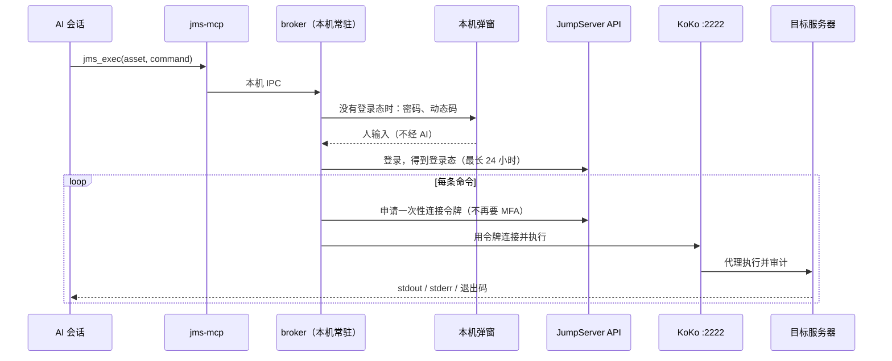

# jms-mcp

让 AI（Claude Code、Codex）经 **JumpServer** 在已纳管的服务器上执行命令的 MCP 服务。

- **登录时输一次，之后不再要**：人在本机弹窗输入 JumpServer 密码和 MFA 动态码，登录态有效期内，连接任何资产、任何账号都不再弹窗。和 JumpServer 网页的体验一致。
- **AI 碰不到密码和动态码**：只由人在本机弹窗输入，AI 不能代填。
- **每条命令都经过 JumpServer**，各自是一次独立的 KoKo 会话，进入审计。



## 文档目录

| 你要做什么 | 看哪篇 |
|---|---|
| 自己装好并换成自己的 JumpServer 用户 | [01-快速上手](docs/01-quickstart.md) |
| 让 AI 知道怎么用这个工具、该遵守什么规矩 | [02-AI 对接指南](docs/02-ai-integration.md) |
| 了解进程模型、有效期、安全边界 | [03-架构与安全](docs/03-architecture.md) |
| 弹窗没出现、登录失败、命令超时等问题 | [04-排障](docs/04-troubleshooting.md) |

## 目录结构

```
jms-mcp/
├── README.md            本文件（索引）
├── docs/                使用文档
├── config.example.json  配置模板（复制到 ~/.jms-mcp/config.json 后修改）
├── src/                 源码（cli / index / broker / ipc / session / jumpserver / service / config / prompt）
├── test/                单元与 broker 测试
└── package.json
```

## 使用前提

| 条件 | 说明 |
|---|---|
| Node.js ≥ 20 | `node -v` 检查 |
| macOS | 已端到端验证 |
| Windows | 需要 Git for Windows 提供的 `pinentry-w32`。桌面弹窗与 broker 常驻行为仍待端到端验证 |
| Linux 与 SSH 远程会话 | 不支持，没有桌面弹窗，会直接报错而不是卡住 |
| 网络 | 本机能访问自己的 JumpServer HTTPS 入口和 KoKo SSH 端口 |
| JumpServer 账号 | 已绑定 MFA（动态码方式），目标资产与账号已授权给你。**不再需要 SSH 私钥** |

## 测试

```bash
npm ci
npm test
```

测试全部使用假的 API 和假的 KoKo 客户端，不会连接真实的 JumpServer。
