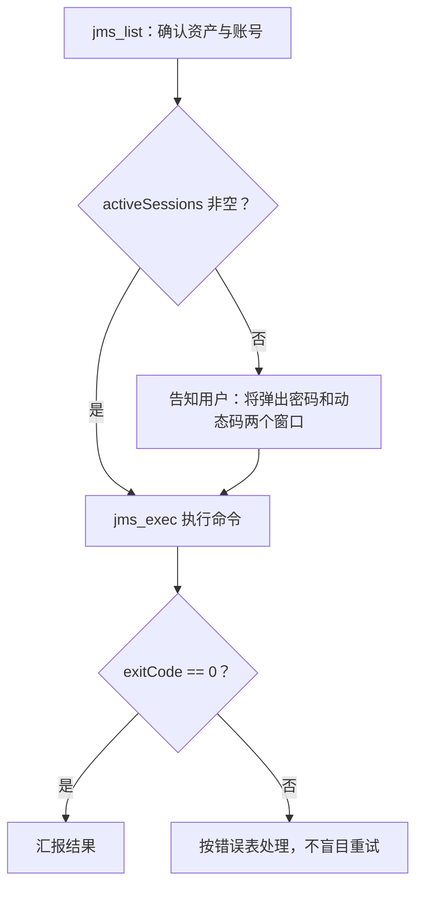

# 02 AI 对接指南

本篇写给 **AI 助手**（Claude Code、Codex 等），也给配置它的人看：工具有哪些、什么时候用、哪些事绝对不能做。

## 什么时候用 jms

- 目标服务器已纳管到 JumpServer（`jms_list` 能列出）→ **优先用 `jms_exec`**，不要走 SSH 直连、跳板或其他 SSH MCP。
- `jms_list` 里没有该资产，或 jms MCP 不可用 → 才回退到别的方式，并向用户说明回退原因。
- 绕过 JumpServer 的直连（如 root 直连）只用于应急，且要用户明确同意。

## 三个工具

### `jms_list`（只读，不触发登录）

无参数。返回：

| 字段 | 含义 |
|---|---|
| `koko` | JumpServer 入口 |
| `ttlHours` | 登录态本地上限 |
| `assets[]` | 可用资产：`name`、`description`、`defaultAccount`、`accounts`、`privilegedAccounts` |
| `activeSessions[]` | 当前登录态：`account` 是 JumpServer 用户名，含 `expiresAt`、`remainingMinutes`；为空表示还没登录或已过期 |
| `warning` | 仅在 broker 运行旧代码时出现，不影响使用 |

**每次开始远程操作前先调用一次**，确认资产名、可用账号，以及是否已登录。

### `jms_exec`

| 参数 | 必填 | 说明 |
|---|---|---|
| `asset` | 是 | 资产名，取自 `jms_list` |
| `command` | 是 | 一条非交互 shell 命令 |
| `account` | 否 | 账号名；不填用资产的非特权默认账号 |
| `privileged` | 否 | 用特权账号时必须同时传 `account` 和 `privileged=true` |
| `timeout_sec` | 否 | 1–600，默认 60 |

返回 `asset`、`account`、`exitCode`、`stdout`、`stderr`、`sessionExpiresAt`（登录态到期时间）；超时会多带 `timedOut` 和 `note`，输出超过 256KB 会带 `truncated`。

### `jms_logout`

结束本机登录态，对所有 AI 会话生效，之后再执行命令要重新输入密码和动态码。**不要在每个任务结束时调用**：登录态到期会自动失效，主动结束会让用户一天里多输好几次密码。只在用户明确要求收回授权，或离开电脑前用户让你收尾时使用。

## 登录是怎么回事

- 没有登录态时，第一次 `jms_exec` 会在用户桌面**依次弹出两个窗口**：先输入 JumpServer 登录密码，再输入 MFA 动态码，各最多等 2 分钟。
- 登录一次后，登录态在本机所有 AI 会话间共享，有效期内**连接任何资产、任何账号都不再弹窗**。
- 每条命令内部会申请一个一次性连接令牌，再连 KoKo 执行，结束即断开。这是内部细节，不需要也不应该由 AI 处理。

## 必须遵守的规则

| 规则 | 原因 |
|---|---|
| **不索要、不代填、不保存密码、OTP、TOTP 种子或令牌** | 密码和动态码只能由人在弹窗里输入，设计上不经过 AI |
| 首次执行前告诉用户「将弹出两个窗口，先密码后动态码，请核对用户名」 | 弹窗最多等 2 分钟，用户没准备好会超时失败 |
| 默认只用非特权账号 | 特权账号（`privileged=true`）登录后不再有额外 MFA，所以仅在用户明确要求，或任务确需 sudo 时使用，并先说明原因 |
| 命令前先判断是否只读 | 每条命令都进入 JumpServer 审计，操作要可追溯、可解释 |
| 写操作、重启、删除先向用户确认 | 生产服务器的变更必须先报告变更内容、影响范围和回滚方式，得到明确确认后再执行 |
| 命令里不写明文密码、令牌 | 命令会原样进入审计日志 |
| 失败时不要反复重试弹窗 | 每次重试都会让用户重复输入；密码连续输错还会触发服务端账号锁定，锁定时间由部署策略决定 |

## 命令书写要点

- 每条命令独立执行，**不保留 cwd 和环境变量**。需要切目录时写 `cd /path && cmd`，或用绝对路径。
- 不支持交互程序（`vim`、`top`、`less`）。要看进程用 `top -bn1`，要看日志用 `tail -n 100`。
- 命令被包在远端 `timeout -k 5 <timeout_sec> bash -c '<命令>'` 里执行，所以审计里看到的是包装后的形式。
- 命令可能耗时较长时，调大 `timeout_sec`（上限 600）；更久的任务让它在远端后台跑，再分次查询结果。
- 输出很大时先过滤再取，例如加 `| head -100`、`grep`、`tail`，避免触发 256KB 截断。

## 典型流程



## 错误与处理

| 返回信息 | 含义 | AI 应该做什么 |
|---|---|---|
| `未输入密码（已取消或超时）` / `未输入 OTP（已取消或超时）` | 用户取消，或 2 分钟内没输入 | 停下，问用户是否重试，不要自动再弹 |
| `用户名或密码错误: … You have N more attempt(s)` | 密码输错，N 是剩余次数。用户已经在弹窗里看到原因；剩余次数充足时已让用户当场重输过，走到这里说明用户没重输成功或次数不够了 | 告知用户剩余次数，**不要自动重试**，让用户确认密码后再试；次数用完可能触发账号锁定，锁定时间由部署策略决定 |
| `MFA 验证失败` | 动态码输错、过期，或同一个码重复使用。弹窗里已让用户重输过最多 3 次，并弹出了失败提示 | 提示用户等验证器刷新出新的动态码，再重试一次 |
| `该账号的 MFA 方式…暂不支持` | 用户的 MFA 不是动态码（OTP） | 告诉用户需要在 JumpServer 里改用动态码方式 |
| `无法连接 JumpServer …` | 网络不通 | 确认本机能访问部署方提供的 JumpServer 入口 |
| `JumpServer 里没有授权给你的资产 X` / `资产 X 上没有授权给你的账号 Y，已授权: …` | 权限没给，或配置里的名字不对 | 告诉用户去 JumpServer 检查授权，AI 不要改任何权限 |
| `申请连接令牌失败: …` | JumpServer 拒绝了该资产或账号的连接 | 把服务端原文告诉用户，不要换账号去试 |
| `KoKo 仍要求 MFA 验证，连接令牌没有生效` | JumpServer 对该资产或账号配了额外的 MFA 规则 | 停止，告诉用户检查 JumpServer 的登录规则 |
| `KoKo 主机指纹校验失败或无法连接` | 网络不通，或指纹不符 | 先让用户确认网络，指纹不符时不要绕过 |
| `KoKo 拒绝了连接令牌（已过期或已被使用）` | 令牌超过 5 分钟或被重复使用 | 重试一次即可，会自动申请新令牌 |
| `主机名核对失败：期望 A，实际 B，未执行命令` | 资产配错，指到了别的机器 | 立即停止，让用户核对配置 |
| `当前进程运行在 SSH 远程会话中` | 在无桌面的环境里启动，弹窗显示不出来 | 告诉用户需要在本机桌面会话里使用 |
| `timedOut: true` | 命令超过 `timeout_sec`，远端已结束该命令 | 不影响登录态；调大超时或拆分命令，不要重试同一条 |
| `X 是特权账号，必须显式指定 account 并设置 privileged=true` | 没按特权方式调用 | 特权账号需用户明确要求 |
| `未知资产` | 资产名不在配置里 | 重新 `jms_list`，不要猜名字 |

登录态过期或被结束后，下一次 `jms_exec` 会自动重新弹窗登录，不需要 AI 做任何特殊处理。

## 给项目规则文件加的一段

把下面这段放进使用方的 `AGENTS.md` 或 `CLAUDE.md`（Codex 放 `~/.codex` 的规则里），AI 就会按本篇约定使用：

```markdown
## JumpServer 纳管资产走 jms MCP

- 目标主机已纳管到 JumpServer（以 `jms_list` 为准）时，远程命令优先用 `jms_exec`，不走 SSH 直连或跳板。
- 没有登录态时首次执行会在用户桌面弹出两个窗口（先密码，后 MFA 动态码）：只提示用户去输入，不索要、代填或保存密码、OTP、TOTP 种子或令牌。
- 登录后连接任何资产、账号都不再弹窗；登录态到期自动失效，不要在每个任务结束时调用 `jms_logout`，仅在用户明确要求收回授权时使用。
- 默认使用非特权账号；特权账号（`privileged=true`）登录后没有额外 MFA，仅在用户明确要求或任务确需 sudo 时使用，并先说明原因。
- 命令前先判断是否只读；写操作、重启、删除先向用户确认。
- 登录失败不要自动重试，密码连续输错会被 JumpServer 锁定账号。
- jms MCP 不可用或资产未纳管时才回退其他方式，并说明原因。
```

---

[← 返回目录](../README.md)
