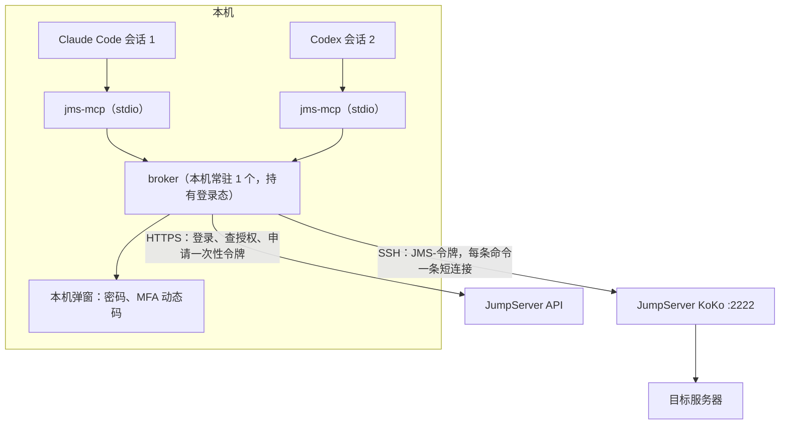
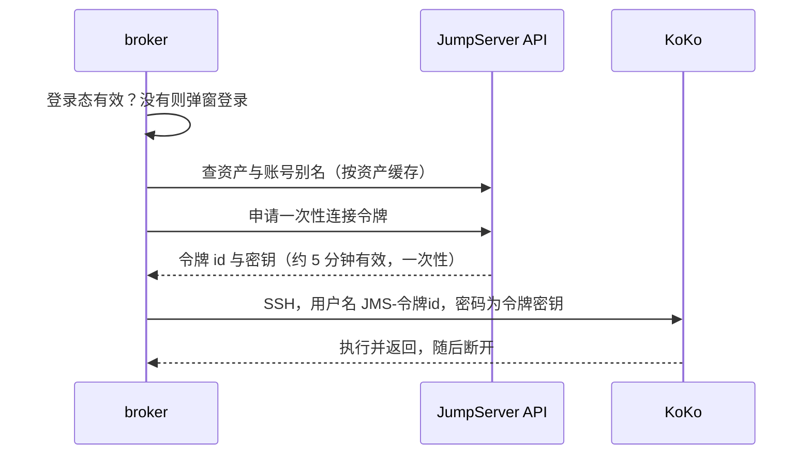

# 03 架构与安全

## 进程模型



- **jms-mcp**：每个 AI 会话启动一个 stdio 进程，只做转发。
- **broker**：全机一个，保存 JumpServer 登录态，并替所有会话执行命令。首次调用时由 MCP 自动拉起，会话结束后继续运行；**没有登录态且空闲 10 分钟**后自动退出。
- 代码或配置变化后，broker 在没有登录态时会被自动替换；有登录态时继续用旧的，`jms_list` 会给出提示。
- 调试可设 `JMS_MCP_MODE=inprocess`，退回登录态随 MCP 进程生灭的模式（每个会话单独登录）。

运行时文件在 `~/.jms-mcp/`（可用 `JMS_MCP_RUNTIME_DIR` 覆盖）：

| 文件 | 说明 |
|---|---|
| `config.json` | 配置（你自己维护） |
| `broker.sock` | macOS 的本机通信端点；路径过长时回退到 `/tmp/jms-mcp-<uid>/` |
| `broker.token` | 本机通信令牌，仅本人可读 |
| `broker.log` | broker 日志：登录、结束及原因，不含密码、OTP 和令牌 |

Windows 用命名管道 `\\.\pipe\jms-mcp-<用户名>-<哈希>`，不生成 `broker.sock`。配置路径可用 `JMS_MCP_CONFIG` 覆盖。

## 一条命令的执行过程



- 令牌是一次性的，用完即作废，不需要吊销，也不复用。
- 每条命令在 JumpServer 里是一次独立的会话记录。
- 登录态被服务端判为失效（401）时，自动重新弹窗登录一次，再重试。

## 多久输一次密码和动态码

**每个登录态输一次**，本机所有 AI 会话共享；有效期内连接任何资产、账号都不再弹窗。登录态在这些情况下结束，之后下一次调用会重新弹窗：

| 情况 | 说明 |
|---|---|
| 达到有效期 | 取 `ttlHours` 与 JumpServer 返回的过期时间中较早的，最长 24 小时 |
| `jms_logout` / `cli.js stop` | 主动收回 |
| JumpServer 判登录态失效 | 例如管理员强制下线、修改密码 |
| broker 退出 | 登录态只在 broker 内存里，broker 退出就丢失 |

因为不再保持长连接，网络波动、电脑睡眠或网络隧道重建**不会**让登录态失效：只会让当前那一条命令失败，网络恢复后再执行即可。

## 弹窗

| 项 | 说明 |
|---|---|
| 样式 | macOS 用 AppKit 的 `NSAlert`（经 `osascript` 的 JXA）：加粗标题、锁形图标、密码框、「登录」「验证」「取消」按钮；输错时换成警示图标并把原因置顶。`NSAlert` 起不来时自动退回系统自带的 `display dialog`（设 `JMS_MCP_DEBUG=1` 可在 stderr 看到退回原因）。Windows 用 `pinentry-w32` |
| 文字不拼进脚本 | 标题、说明、按钮文字都作为命令行参数传给弹窗进程，不拼进脚本源码，任意字符都不需要转义 |
| 等待时长 | 密码 5 分钟（找密码可能要翻密码管理器），动态码 2 分钟（密码通过后马上输）。正文里会写明「N 分钟内未输入，窗口将自动关闭」 |
| 超时后 | 窗口自动关闭，macOS 发一条系统通知说明原因；返回给 AI 的错误写明「窗口等待 N 分钟无人输入，已自动关闭」，与用户主动取消区分开 |
| 最长占用 | 一次 `jms_exec` 里弹窗最长约 22 分钟（密码、动态码各最多 3 次），MCP 与 broker 的等待预算按此设置，**MCP 客户端的工具超时要大于它**，见快速上手里 Codex 的 `tool_timeout_sec` |

## 安全边界

| 设计 | 说明 |
|---|---|
| 密码与动态码只经弹窗 | Windows 用 Git for Windows 的 `pinentry-w32`，macOS 用系统 `osascript` 隐藏输入框；不返回给 AI、不写日志、不落盘 |
| 密码用后即丢 | 密码只用于登录那一次 API 调用，登录态里不保留；保存的只有登录令牌，仅在 broker 内存里 |
| 弹窗说明来意 | 标题和正文写明 JumpServer 用户、是哪个资产与账号触发了登录、为什么要输入密码、密码如何处理、有效期；用户看到意料之外的弹窗时可以拒绝输入 |
| 输错必让用户知道 | 密码或动态码输错时，弹窗里用「⚠️」写明原因与剩余次数并让用户重输；密码最多输 3 次，剩余次数低于 3 时不再当场重输；其余失败弹出提示框。用户主动取消不弹提示 |
| 特殊字符原样处理 | 密码经弹窗的标准输出传回、以 JSON 原样提交，引号、反斜杠、`%`、`$`、反引号、中文和首尾空格都不转义、不裁剪；弹窗正文里的文字另做 AppleScript 与 Assuan 转义 |
| 登录成功有通知 | macOS 登录成功后发一条非打断式系统通知，写明有效期；Windows 暂无 |
| 绝对有效期 | 最长 24 小时，到点作废；`jms_logout` 或 `cli.js stop` 可随时收回 |
| 特权账号没有额外 MFA | 登录态有效期内，申请特权账号的令牌同样不再要 MFA，和普通账号一样。靠「默认非特权、特权需显式指定」限制 AI 误用，不是再验证一次人 |
| broker 仅限本人 | macOS 用 0700 目录下的 unix socket，Windows 用带用户名的命名管道；每个请求还需带只有本人可读的随机令牌 |
| 同机同用户可借用 | 有效期内，**以你的用户身份运行的任何本机进程**都能借用登录态，包括申请特权账号的令牌。离开电脑或不再使用时执行 `cli.js stop` |
| 主机指纹固定 | KoKo 公钥 SHA256 不符即拒绝 |
| 主机名核对 | 配了 `expectHostname` 时，每个账号首次使用前先核对，防止资产配错 |
| 远程会话拒绝弹窗 | 检测到运行在 SSH 会话中直接报错，不会卡住 |
| 配置不含机密 | 配置只写用户名、资产名和账号，没有密码或令牌 |

## 命令超时

KoKo 不会把本地发出的 KILL 信号转发到资产，只关本地通道会让远端进程继续运行。因此默认在远端包一层 coreutils `timeout`：

```bash
timeout -k 5 <timeout_sec> bash -c '<原命令>'
```

- 到时先发 TERM，5 秒后仍未结束再发 KILL，作用于整个进程组（含子进程）；退出码 124/137 返回 `timedOut: true`。
- 本地另留 10 秒兜底：远端没按时结束时，本地关闭通道并直接返回，提示远端进程可能仍在运行。
- 资产没有 `timeout`/`bash`（如非 Linux）时，在该资产配置里设 `"remoteTimeout": false`，退回只关本地通道。

## 源码结构

| 文件 | 职责 |
|---|---|
| `src/cli.js` | 入口：无参数启动 MCP；子命令 `broker`、`status`、`stop` |
| `src/index.js` | MCP 服务，注册 `jms_list`、`jms_exec`、`jms_logout` |
| `src/broker.js` | 常驻进程，监听本机 IPC，持有登录态 |
| `src/ipc.js` | 本机通信：端点、令牌、请求、拉起与替换 broker |
| `src/session.js` | 登录态管理、一次性令牌连 KoKo、命令执行与超时 |
| `src/jumpserver.js` | JumpServer API 客户端：登录、查授权、申请连接令牌 |
| `src/service.js` | 业务逻辑：资产与账号校验、主机名核对、远端超时包装 |
| `src/config.js` | 读取并校验配置 |
| `src/prompt.js` | 密码与动态码弹窗（osascript / pinentry） |

---

[← 返回目录](../README.md)
